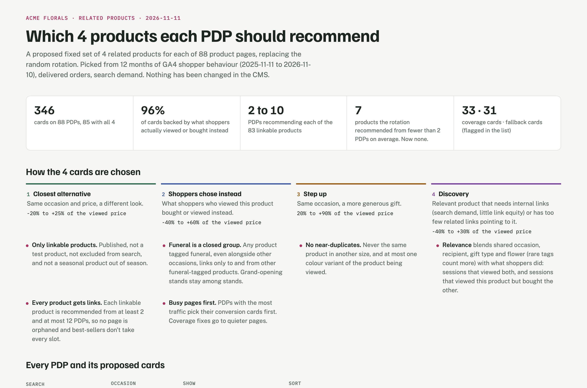
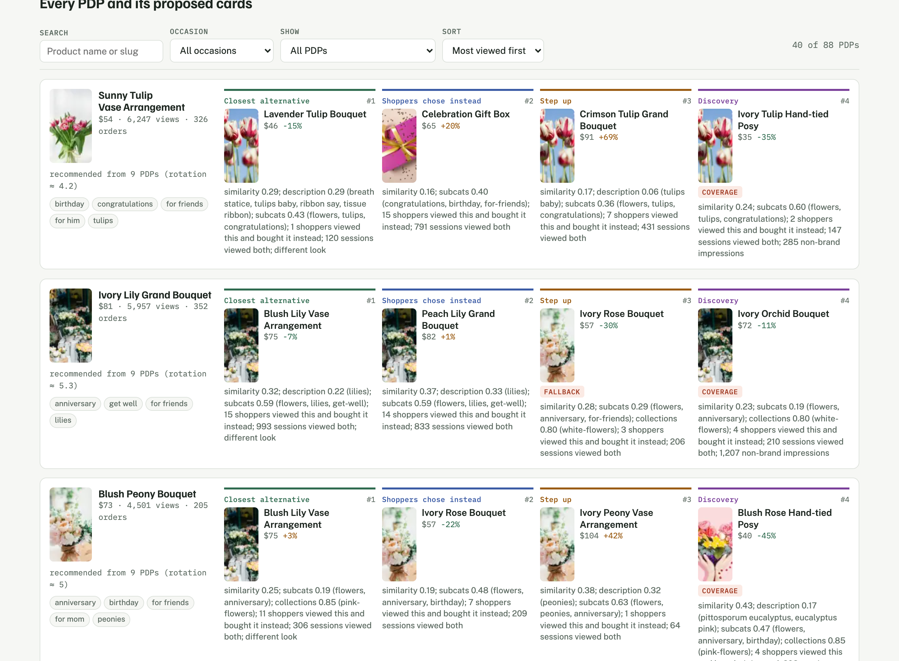

# Related Products

Most storefronts fill the "You may also like" row on a product page with four random products from
the same category. This engine picks those four on purpose, for every product page, and explains
each pick.

Each card answers a different reason a shopper does not buy the product in front of them:

| Slot | Answers | Price band |
|---|---|---|
| **Closest alternative** | "I like it, but not this look" | -20% to +25% |
| **Shoppers chose instead** | what people who viewed this product actually bought or viewed instead | -40% to +60% |
| **Step up** | "I want something more generous" | +20% to +90% |
| **Discovery** | a relevant product that needs internal links (search demand, few links pointing to it) | -40% to +30% |



## Results

Built for a group of gifting ecommerce shops and run as a paired A/B test (half the products got
engine sets, half kept the random rotation). In the first nine days, **related-card clicks per
product view were 7.75% on engine pages against 2.64% on rotation pages, +75% paired**
(95% CI +29% to +106%). The engine sets then went live on every product page.

## Every pick has a reason

The report lists every product page with its four cards and why each was picked: content
similarity (shared occasion, recipient, gift type and flower, collections, the product's own
description), shopper behaviour (sessions that viewed both, sessions that viewed this one but
bought the other), price, and the coverage rules.



## Rules it keeps

- **Content first.** Two bestsellers viewed together a lot are not "related" if they are different
  kinds of gift: every card clears a content-similarity floor before behaviour counts.
- **Closed lanes.** Sympathy products link only to and from sympathy products; a grand-opening
  stand never shows on a birthday bouquet.
- **No near-duplicates.** Never the same product in another size, at most one colour variant.
- **Every product gets links.** Each linkable product is recommended from at least 2 and at most
  12 pages, so nothing is orphaned and bestsellers do not take every slot.
- **Only what can be bought.** Unpublished, search-excluded and out-of-season products get no
  cards, and in multi-hub shops a card must be on sale wherever the product is.
- **Seasons.** Before Valentine's, Mother's Day or Christmas, `--date` boosts the season's
  products and blends in last year's behaviour from the same window (`relprod/seasons.py`).

## Quick start

```bash
git clone https://github.com/rodrig0055/related-products && cd related-products
uv run python examples/make_demo.py           # a synthetic shop in cache/demo/
uv run run.py build --shop demo               # out/demo/<date>/
uv run python -m relprod.report out/demo/<date>   # report.html
```

`make_demo.py` invents 88 products for a fictional florist, Acme Florals, and simulates 60,000
shopping sessions, so the behaviour signals look like a real GA4 export.

A run writes:

| File | What |
|---|---|
| `product_related.csv` / `.sql` | `product_id, related_product_id, prioritization`: ready to import |
| `related.csv` | one row per card, with slot, scores and the reason |
| `products.csv` | every product with its signals and inbound links before and after |
| `summary.json`, `report.html` | totals and the review page |

## Your own shop

1. Add a `Shop` in `relprod/shops.py`: map your category slugs to facets (occasion, recipient,
   flower, kind) and name your closed lanes and seasonal occasions.
2. Export your catalog, sales and collections to `cache/<shop>/` (the file contract is in the
   docstring of `relprod/sources.py`). Only the catalog is required.
3. Shopper behaviour and search demand come from the standard GA4 and Search Console BigQuery
   exports: set `ga4_table` and `gsc_table`, install the `bigquery` extra and run with `--refresh`.

## Measure it

- `relprod.uplift` estimates the value before any test, using the random rotation as a natural
  experiment.
- `relprod.abtest` pairs similar products, assigns arms and reads the result from GA4.
- `relprod.learn` feeds measured clicks back: a card that draws fewer clicks than its position's
  average gives way to an equally relevant one nobody has tried yet.

## Tests

```bash
uv run --group dev pytest -q                          # engine rules on small fixtures
uv run python -m tests.test_engine out/demo/<date>    # invariants on a real run
```

Demo photos are from [Unsplash](https://unsplash.com) and downloaded when the report is built.

## License

MIT
